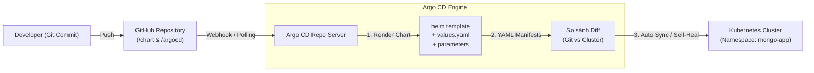

# 📘 Hướng Dẫn Chi Tiết: Quản Lý & Triển Khai Helm Chart Bằng Argo CD (GitOps)

Tài liệu này giải thích chi tiết cơ chế hoạt động, cấu trúc và từng trường cấu hình trong các file Argo CD khi kết hợp với Helm Chart trong dự án này.

---

## 1. Cơ Chế Argo CD Quản Lý Helm Chart Như Thế Nào?

Thông thường, khi dùng Helm bằng tay, bạn chạy lệnh:
```bash
helm install my-release ./chart -f my-values.yaml
```
Khi dùng với **Argo CD**, bạn **không** chạy lệnh `helm install` trực tiếp trên cụm nữa:
1. Thành phần **`argocd-repo-server`** tự động clone mã nguồn từ Git về.
2. Nó phát hiện trong thư mục `chart/` có file `Chart.yaml`, nên nó sẽ tự động chạy công cụ Helm tích hợp sẵn:
   ```bash
   helm template <release-name> <chart-path> -f <valueFiles> --set <parameters>
   ```
3. Argo CD lấy toàn bộ manifest YAML được render ra, so sánh (Diff) với trạng thái hiện tại trên Kubernetes Cluster.
4. Nếu có sự khác biệt (Out-of-Sync), Argo CD sẽ tự động `kubectl apply` các tài nguyên vào Cluster (hoặc đợi bạn bấm nút Sync nếu tắt tính năng Auto-sync).



---

## 2. Giải Thích Chi Tiết File `argocd/application.yaml`

Đây là file khai báo cốt lõi của Argo CD (Custom Resource Definition: `Application`).

```yaml
apiVersion: argoproj.io/v1alpha1
kind: Application
metadata:
  name: mongo-stack                  # Tên định danh của ứng dụng trên giao diện Argo CD
  namespace: argocd                  # Namespace nơi Argo CD được cài đặt
  labels:
    app.kubernetes.io/name: mongo-stack
    app.kubernetes.io/part-of: k8s-tutorial
  finalizers:
    - resources-finalizer.argocd.argoproj.io # Giúp xoá sạch các tài nguyên con khi xoá App
spec:
  project: default                   # Project quản lý ứng dụng (mặc định là default)
  
  # --- 1. NGUỒN KHAI BÁO (SOURCE) ---
  source:
    repoURL: https://github.com/anptitd22/k8s-tutorial.git # Kho Git chứa Helm Chart
    targetRevision: main             # Nhánh Git, Tag hoặc Commit hash cần theo dõi
    path: chart                      # Đường dẫn tới thư mục chứa Chart.yaml trong repo

    # Cấu hình riêng cho Helm
    helm:
      valueFiles:
        - values.yaml                # Sử dụng file giá trị mặc định của chart

  # --- 2. ĐÍCH ĐẾN TRIỂN KHAI (DESTINATION) ---
  destination:
    server: https://kubernetes.default.svc # Cụm K8s nội bộ đang chạy Argo CD
    namespace: mongo-app             # Namespace sẽ deploy MongoDB & Mongo Express tới

  # --- 3. CHÍNH SÁCH ĐỒNG BỘ (SYNC POLICY) ---
  syncPolicy:
    automated:                       # Bật tự động hoá đồng bộ (GitOps hoàn toàn)
      prune: true                    # Tự động xoá tài nguyên trên K8s nếu bị xoá trên Git
      selfHeal: true                 # Tự sửa lại trạng thái nếu có ai sửa tay trong cluster
    syncOptions:
      - CreateNamespace=true         # Tự tạo namespace 'mongo-app' nếu chưa tồn tại
    retry:                           # Thử lại nếu quá trình đồng bộ gặp trục trặc tạm thời
      limit: 5
      backoff:
        duration: 5s
        factor: 2
        maxDuration: 3m
```

### Các trường quan trọng cần lưu ý:
- **`source.path: chart`**: Argo CD tìm đến thư mục `chart`. Do thấy có file `Chart.yaml`, Argo CD tự động kích hoạt **Helm Engine**.
- **`source.helm.valueFiles`**: Danh sách các file cấu hình `values` sẽ được nạp vào lúc render template.
- **`selfHeal: true`**: Tính năng then chốt của GitOps. Nếu có ai đó dùng lệnh `kubectl delete pod` hoặc `kubectl edit deployment` ngoài cụm, Argo CD sẽ phát hiện sự sai lệch và đè lại cấu hình từ Git về.

---

## 3. Triển Khai Đa Môi Trường Bằng Cách Ghi Đè Tham Số Helm

Argo CD cho phép bạn dùng **chung một Helm Chart** trong thư mục `chart/`, nhưng có thể tạo ra nhiều môi trường khác nhau (**Dev**, **Staging**, **Prod**) mà không cần copy code chart.

### File `argocd/environments/application-dev.yaml`
Dùng cho môi trường Development, tối ưu tài nguyên (1 replica, dùng Service kiểu NodePort để test):

```yaml
spec:
  source:
    path: chart
    helm:
      valueFiles:
        - values.yaml
      parameters:
        # Tương đương: helm install --set mongoExpress.replicaCount=1
        - name: mongoExpress.replicaCount
          value: "1"
        # Tương đương: helm install --set mongoExpress.service.type=NodePort
        - name: mongoExpress.service.type
          value: "NodePort"
  destination:
    namespace: mongo-dev             # Triển khai vào namespace riêng cho dev
```

### File `argocd/environments/application-prod.yaml`
Dùng cho môi trường Production, đảm bảo tính sẵn sàng cao (2 replicas, bật Ingress và dùng Service ClusterIP):

```yaml
spec:
  source:
    path: chart
    helm:
      valueFiles:
        - values.yaml
      parameters:
        - name: mongoExpress.replicaCount
          value: "2"
        - name: mongoExpress.service.type
          value: "ClusterIP"
        - name: mongoExpress.ingress.enabled
          value: "true"
        - name: mongoExpress.ingress.hosts[0].host
          value: "mongo-express-prod.antd"
  destination:
    namespace: mongo-prod            # Triển khai vào namespace cô lập cho production
```

> [!TIP]
> **Kinh nghiệm thực tế:**
> Ngoài cách dùng `parameters` (tương đương cờ `--set` của Helm), bạn cũng có thể lưu sẵn các file trong thư mục chart như `values-dev.yaml`, `values-prod.yaml` và gọi qua `valueFiles: ["values.yaml", "values-dev.yaml"]`.

---

## 4. Mô Hình Root Application: "App of Apps" Pattern (`argocd/app-of-apps.yaml`)

Khi hệ thống có hàng chục microservices hoặc nhiều môi trường, việc gõ lệnh `kubectl apply -f ...` cho từng file `application.yaml` sẽ rất thủ công. 

Mô hình **App-of-Apps** giải quyết bài toán này: **Dùng 1 Application của Argo CD để quản lý các Application khác.**

```yaml
apiVersion: argoproj.io/v1alpha1
kind: Application
metadata:
  name: root-application
  namespace: argocd
spec:
  project: default
  source:
    repoURL: https://github.com/anptitd22/k8s-tutorial.git
    targetRevision: main
    path: argocd/environments        # Thư mục chứa application-dev.yaml và application-prod.yaml
    directory:
      recurse: true                  # Quét đệ quy tất cả các file Application trong thư mục
  destination:
    server: https://kubernetes.default.svc
    namespace: argocd                # Các Application con sẽ được tạo trong namespace argocd
  syncPolicy:
    automated:
      prune: true
      selfHeal: true
```

**Lợi ích:**
- Bạn chỉ cần chạy duy nhất 1 lệnh:
  ```bash
  kubectl apply -f argocd/app-of-apps.yaml
  ```
- Khi bạn muốn thêm một môi trường mới (ví dụ `application-staging.yaml`), bạn chỉ cần commit file đó vào thư mục `argocd/environments/`. Argo CD tự động phát hiện và sinh ra môi trường mới mà không cần can thiệp lệnh `kubectl` nào nữa!

---

## 5. File Phân Quyền Bảo Mật: `argocd/project.yaml`

Theo mặc định, Argo CD sử dụng project mang tên `default` có toàn quyền. Tuy nhiên, trong môi trường doanh nghiệp, file `AppProject` giúp thiết lập hàng rào bảo mật:

```yaml
apiVersion: argoproj.io/v1alpha1
kind: AppProject
metadata:
  name: k8s-tutorial-project
  namespace: argocd
spec:
  description: Project dành cho k8s-tutorial
  
  # 1. Chỉ cho phép kéo code từ repo chính thống này:
  sourceRepos:
    - https://github.com/anptitd22/k8s-tutorial.git

  # 2. Giới hạn chỉ được deploy vào các namespace có tiền tố mongo-*:
  destinations:
    - namespace: "mongo-*"
      server: https://kubernetes.default.svc
    - namespace: "default"
      server: https://kubernetes.default.svc

  # 3. Giới hạn các tài nguyên cấp Cluster:
  clusterResourceWhitelist:
    - group: ""
      kind: Namespace

  # 4. Cho phép tạo mọi tài nguyên thông thường trong Namespace đích:
  namespaceResourceWhitelist:
    - group: "*"
      kind: "*"
```

---

## 6. Bảng Tra Cứu Các Cách Cung Cấp Giá Trị (Values) Cho Helm Trong Argo CD

| Cách làm | Trường khai báo trong Application | Trường hợp sử dụng phù hợp |
| :--- | :--- | :--- |
| **Dùng file có sẵn** | `source.helm.valueFiles` | Khi cấu hình mặc định đã được chuẩn hoá sẵn trong Git (ví dụ `values.yaml`). |
| **Ghi đè tham số đơn lẻ** | `source.helm.parameters` | Khi chỉ cần thay đổi 1 vài biến nhỏ giữa các môi trường (ví dụ `replicaCount`, `image.tag`). |
| **Nhúng YAML trực tiếp** | `source.helm.valuesObject` hoặc `values` | Khi muốn khai báo một khối cấu hình phức tạp trực tiếp ngay trong file Application. |

Ví dụ khai báo `valuesObject` trực tiếp:
```yaml
source:
  path: chart
  helm:
    valuesObject:
      mongoExpress:
        replicaCount: 3
        image:
          tag: "0.54.0"
```

---

## 7. Các Lệnh Hữu Ích Khi Làm Việc Với Helm & Argo CD

```bash
# 1. Thử nghiệm render template tại máy local trước khi push Git:
helm template my-release ./chart -f ./chart/values.yaml

# 2. Xem chi tiết trạng thái render của Argo CD Application:
kubectl describe application mongo-stack -n argocd

# 3. Ép Argo CD đồng bộ lại ngay lập tức qua lệnh:
kubectl annotate application mongo-stack -n argocd argocd.argoproj.io/refresh=hard --overwrite

# 4. Kiểm tra lịch sử đồng bộ của ứng dụng:
kubectl get application mongo-stack -n argocd -o yaml
```
